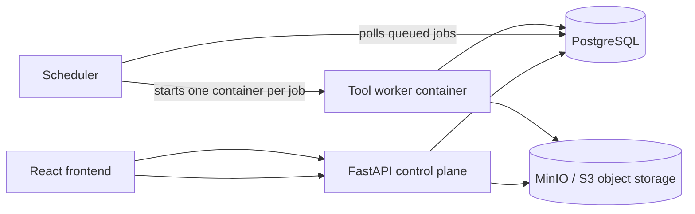

# BetzLab Toolbox architecture

The platform is a control plane (FastAPI + PostgreSQL) that never runs heavy
analysis itself. Large files live in object storage. A scheduler watches for
queued jobs and starts one temporary worker container per job, on whichever
machine is running that scheduler. This is what lets different tools - and
different machines - be added without changing the core application.



## Why this shape

- **The API is stateless with respect to analysis.** It creates a `Job` row
  and returns immediately. It can be scaled or restarted without losing
  in-flight work.
- **Object storage, not shared disks, carries the data.** A worker container
  only needs network access to MinIO/S3 and the database - it can run on any
  machine, including a remote one with different hardware (e.g. a GPU box).
- **Containers only run while a job is active.** The scheduler starts a
  container per job and lets it exit (`remove=True`); there is no idle worker
  process consuming resources between jobs.
- **Each tool is an independent image.** A tool's dependencies, runtime, and
  even OS packages can differ from every other tool's, because they never
  share a container.

See [ADDING_A_NEW_TOOL.md](ADDING_A_NEW_TOOL.md) for the concrete
steps to add a tool, or
[INTEGRATING_AN_EXISTING_FUNCTION.md](INTEGRATING_AN_EXISTING_FUNCTION.md)
if you already have a working `analysis(image, params) -> image` function to
wrap.

## Backend layout

```text
backend/
  main.py                  API entrypoint: auth, uploads, /tools, job creation
  auth.py                  JWT auth and password hashing
  database.py              SQLAlchemy engine/session
  models.py                User, File, Job ORM models
  storage.py                MinIO/S3 client wrapper (upload/download/cache)
  tool_registry.py         The list of tools, their parameters, and their worker image
  scheduler/
    dispatcher.py          Polls for queued jobs, starts one container per job
  worker_base/
    contracts.py            ToolContext / ToolResult shared by every tool
    runner.py               Generic container entrypoint: download -> process -> upload -> report
  tools/
    beadbuddy/
      processor.py           BeadBuddy's process() function
      Dockerfile             Worker image for BeadBuddy jobs
    mbr_analysis/            Registry entry only, until implemented
    traction_force/          Registry entry only, until implemented
    segmentation_3d/         Registry entry only, until implemented
```

## Job lifecycle

```text
queued        -> job row created by POST /tools/{tool_id}/run
dispatching   -> scheduler claimed the row (atomic UPDATE, avoids double dispatch)
running       -> worker container started, downloading/processing
completed     -> worker uploaded result + metadata, updated the job row
failed        -> worker (or scheduler) recorded an error_message
```

The frontend polls `GET /job/{job_id}` and treats `completed`/`failed` as
terminal.

## Frontend layout

```text
frontend/src/
  App.tsx                  Application shell and view routing (login/register/dashboard/tool)
  components/              Shared authentication components
  pages/
    ToolDashboard.tsx       Renders cards from GET /tools - no hardcoded tool list
    ToolWorkspace.tsx       Generic upload/run/slice/download workflow for any tool
  services/
    api.ts                  HTTP client: auth, tools, upload, run, slice, download
    authApi.ts              Re-exports the auth functions tool pages need
  types/tool.ts             Tool/ToolParameter shape shared with the backend registry
```

A tool whose UI doesn't fit the generic upload/slice/download shape gets its
own page under `pages/`, rendered from `App.tsx` based on `activeTool.id`
(see docs/ADDING_A_NEW_TOOL.md).

## Local development

```bash
docker compose up --build          # db, minio, backend, scheduler, frontend
docker compose --profile tools build   # build worker images (e.g. beadbuddy-worker)
```

The scheduler needs the worker images to exist locally (or in a registry it
can pull from) before it can dispatch jobs for that tool.

## Running workers on a separate machine

Nothing in this design is tied to a single host. To add a remote worker
machine:

1. Push the tool's image to a registry both machines can reach.
2. Run another copy of `scheduler/dispatcher.py` on the remote machine,
   pointed at the same `DATABASE_URL` and MinIO/S3 endpoint, with Docker
   available locally on that machine.
3. Both scheduler instances race to claim queued jobs safely (the claim is a
   conditional `UPDATE ... WHERE status = 'queued'`), so this works without
   any extra coordination service.

For larger deployments, replacing the Docker Engine calls in
`scheduler/dispatcher.py` with Kubernetes Job creation (or Nomad) is the
natural next step - the rest of the system (registry, contracts, runner)
does not need to change.

